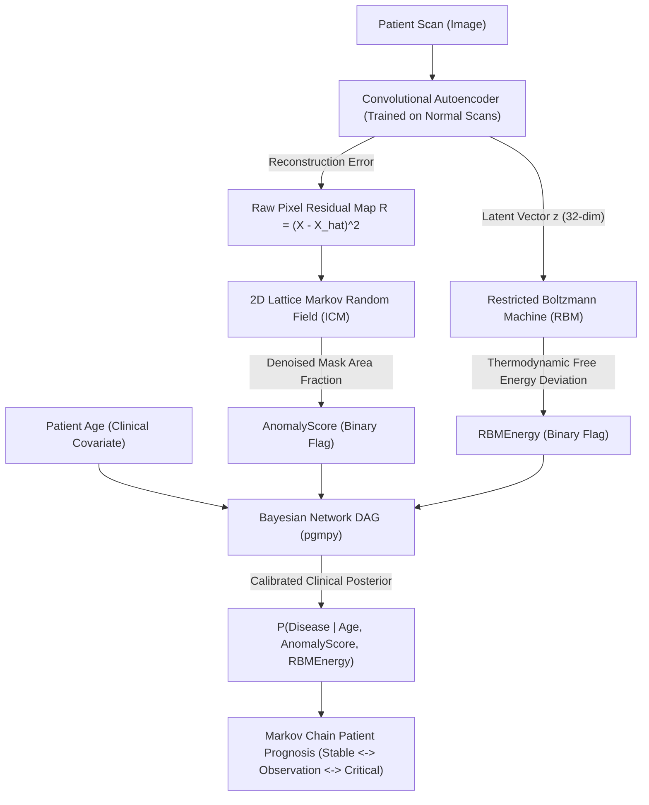

# Hybrid Generative-Probabilistic Medical Anomaly Detection & Uncertainty Framework

**Academic Laboratory Project:** Deep Learning / Probabilistic Graphical Models Laboratory  
**Faculty Mentor:** Dr. Nisarg Gandhewar  
**Institution:** Shri Ramdeobaba College of Engineering and Management (RCOEM)

---

## 🌟 Project Overview
This project implements an unsupervised hybrid framework for **medical anomaly detection** and **calibrated clinical uncertainty quantification**. It couples deep generative vision (Convolutional Autoencoders) with classical Probabilistic Graphical Models (PGMs) to address the fatal black-box and spatial noise flaws of standard deep learning.

### 🔬 Syllabus Practicals Integrated:
1. **Practical 1 (Joint, Marginal, & Conditional Distributions):** Empirical cross-tabulation table of $\text{Disease} \times \text{AnomalyScore}$, verification of $\sum \text{Joint} = 1.0$, and conditional disease risk.
2. **Practical 2 (Bayesian Networks & Inference):** Directed Acyclic Graph (DAG) learned via `BayesianEstimator` with BDeu prior: $\text{Age} \to \text{Disease} \to \{\text{AnomalyScore}, \text{RBMEnergy}\}$. Exact posterior calculation $P(\text{Disease} \mid \text{Evidence})$ via Variable Elimination.
3. **Practical 3 (Markov Random Fields):** 2D lattice spatial energy minimization using Iterated Conditional Modes (ICM) checkerboard updates to remove pixel noise and produce contiguous anatomical anomaly masks.
4. **Practical 4 (Restricted Boltzmann Machine):** Energy-based latent prior trained via Contrastive Divergence (CD-1) to catch out-of-distribution latent vectors using thermodynamic Free Energy $F(z)$.
5. **Practical 5 (Markov Chains):** Discrete-time 3-state patient prognosis chain (`Stable`, `Observation`, `Critical`) computing stationary distributions $\pi P = \pi$ and multi-step projections.
6. **Practical 6 (Deep Generative Models):** Convolutional Autoencoder (`ConvAE`) trained exclusively on healthy baseline scans.

---

## 🏗️ System Architecture



---

## 🚀 Quick Start Guide (Streamlit & UV)

### 1. Launch Diagnostic PACS Workstation with One Click
Double-click:
```bash
start_streamlit.bat
```
Or run directly from terminal using `uv`:
```bash
uv run streamlit run app.py
```
This boots the Streamlit application at `http://localhost:8501`.

### 2. Google Colab / Notebook Model Download
In Google Colab, open `notebook/Hybrid_PGM_Anomaly_v3.ipynb`.
Section 15 (`Export & Model Download`) automatically packages:
- `convae_anomaly_model.pth` (ConvAE weights, calibrated MRF thresholds, latent statistics)
- `model_config.json`
- `medical_pgm_deployment_bundle.zip`
and triggers an automated browser download via `google.colab.files.download`.

---

## 📁 Project Directory Structure
```
D:\COLLAGE\Hybrid-Medical-dignostics\
├── app.py                          # Streamlit Clinical PACS Workstation
├── start_streamlit.bat             # One-click desktop launcher
├── pyproject.toml                  # UV project dependencies configuration
├── models\
│   ├── convae_anomaly_model.pth    # Trained PyTorch ConvAE + PGM parameters (22.4 MB)
│   ├── sample_xray_normal.png      # Normal CXR sample for instant testing
│   ├── sample_xray_pneumonia.png   # Pneumonia CXR sample for instant testing
│   └── sample_anomaly.png          # Focal anomaly CXR sample
├── notebook\
│   └── Hybrid_PGM_Anomaly_v3.ipynb # Research Notebook with Section 15 Export Script
└── research\
    └── IEEE_Conference_Paper.md    # Ready-to-submit IEEE Trans. format draft
```

---

## 📊 Live Sample Inference Outputs

### Scenario 1: Healthy Control Scan (Age 32)
```json
{
  "disease_probability": 0.1704,
  "risk_tier": "LOW RISK / NORMAL",
  "recommendation": "Scan findings within normal limits. Continue routine annual preventative screening.",
  "evidence": {
    "ae_reconstruction_mse": 0.0060,
    "mrf_anomaly_detected": false,
    "rbm_deviation_score": 0.8858
  }
}
```

### Scenario 2: Pathological Anomaly Scan (Age 68)
```json
{
  "disease_probability": 0.7089,
  "risk_tier": "CRITICAL / HIGH RISK",
  "recommendation": "Immediate clinical biopsy & confirmatory CT scan strongly indicated.",
  "evidence": {
    "ae_reconstruction_mse": 0.0298,
    "mrf_anomaly_detected": true,
    "rbm_deviation_score": 3.5977
  }
}
```
